<h1 align="center">🖋️ Neon Tattoo · Tattoo Studio Front</h1>

<p align="center">
  Aplicación web para gestionar las citas de un estudio de tatuajes: registro de usuarios, login con roles y gestión de citas.
</p>

<p align="center">
  <a href="https://abrahamgalvezv.github.io/Tattoo_Studio_Front/"><strong>🚀 Ver la demo</strong></a>
  ·
  <a href="https://github.com/AbrahamGalvezV/Tattoo_Studio_Backend"><strong>⚙️ Repositorio del backend</strong></a>
</p>

<p align="center">
  
  
  
  
  
  
  
</p>

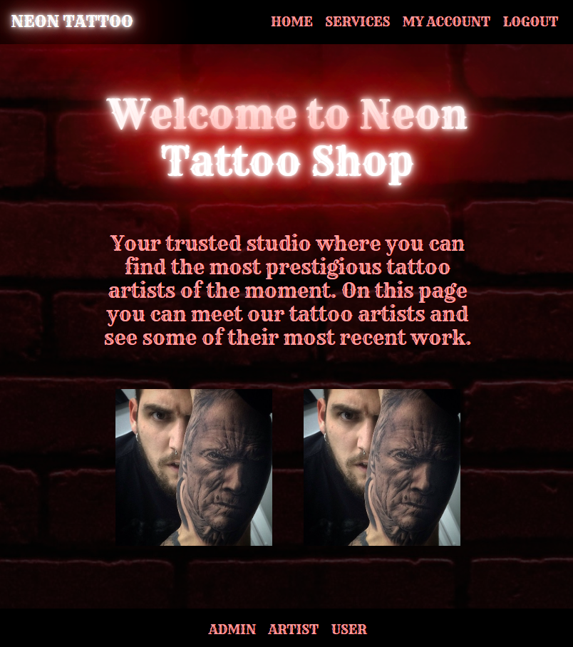

<details>
  <summary><strong>Contenido 📝</strong></summary>

- [Objetivo](#objetivo-)
- [Funcionalidades](#funcionalidades-)
- [Stack](#stack-️)
- [Instalación en local](#instalación-en-local-)
- [Variables de entorno](#variables-de-entorno-)
- [Scripts](#scripts-)
- [Deploy](#deploy-)
- [Estructura del proyecto](#estructura-del-proyecto-)
- [Roles y rutas](#roles-y-rutas-)
- [Vistas](#vistas-️)
- [Futuras funcionalidades](#futuras-funcionalidades-)
- [Agradecimientos](#agradecimientos-)
- [Contacto](#contacto-)

</details>

## Objetivo 🎯

Conectar una API propia con la parte frontal, aplicando lo aprendido en clase, para que la página tenga una base de datos donde los usuarios puedan registrarse y pedir citas.

Este repositorio contiene el **frontend**. La API REST que lo alimenta (Node.js + Express + TypeORM + MySQL) está en [Tattoo_Studio_Backend](https://github.com/AbrahamGalvezV/Tattoo_Studio_Backend).

## Funcionalidades ✨

- 🔐 **Registro y login** con autenticación por JWT.
- 👥 **Tres roles** (administrador, artista y cliente), cada uno con su panel y sus permisos.
- 📅 **Gestión de citas**: el cliente pide y consulta sus citas, el artista ve las suyas y el administrador las gestiona todas.
- 🧑‍💼 **Panel de administración** para buscar y eliminar usuarios.
- ✏️ **Edición del perfil** desde un modal, con validación de los campos.
- 🔎 **Buscador con debounce** en las tablas de usuarios y citas.
- 💾 **Sesión persistente** con Redux Toolkit y `redux-persist`.
- ⚡ **Acceso rápido** desde el footer para probar cada rol sin registrarse.

## Stack 🛠️

| Área | Tecnologías |
| --- | --- |
| UI | React 18, React Bootstrap, CSS |
| Estado | Redux Toolkit, React Redux, redux-persist |
| Navegación | React Router 6 |
| Peticiones HTTP | Axios |
| Utilidades | react-jwt, dayjs |
| Herramientas | Vite 5, ESLint |
| Deploy | GitHub Pages + GitHub Actions |

## Instalación en local 💻

**Requisitos:** Node.js 18 o superior y el [backend](https://github.com/AbrahamGalvezV/Tattoo_Studio_Backend) en marcha (por defecto en `http://localhost:3000`).

```bash
# 1. Clona el repositorio
git clone https://github.com/AbrahamGalvezV/Tattoo_Studio_Front.git
cd Tattoo_Studio_Front

# 2. Instala las dependencias
npm install

# 3. Arranca el servidor de desarrollo
npm run dev
```

La aplicación se abre en `http://localhost:5173`.

### Arrancar el backend

```bash
git clone https://github.com/AbrahamGalvezV/Tattoo_Studio_Backend.git
cd Tattoo_Studio_Backend
npm install
# Crea un archivo .env a partir de .env-sample (datos de MySQL + JWT_SECRET)
npm run db:migrate
npm run db:seed
npm run dev
```

### Usuarios de prueba

Si cargas los datos de ejemplo del backend (`npm run db:seed`), puedes entrar con:

| Rol | Email | Contraseña |
| --- | --- | --- |
| Administrador | `admin1@admin.com` | `12345678` |
| Artista | `artist1@artist.com` | `12345678` |
| Cliente | Regístrate desde la vista **Register** | La que elijas |

## Variables de entorno 🔧

| Variable | Descripción | Valor por defecto |
| --- | --- | --- |
| `VITE_API_URL` | URL base de la API, incluido el prefijo `/api` | `http://localhost:3000/api` |

En local puedes crear un archivo `.env.local` en la raíz del proyecto:

```env
VITE_API_URL=http://localhost:3000/api
```

## Scripts 📜

| Comando | Qué hace |
| --- | --- |
| `npm run dev` | Arranca el servidor de desarrollo de Vite |
| `npm run build` | Genera la versión de producción en `dist/` |
| `npm run preview` | Sirve en local la versión de producción |
| `npm run lint` | Revisa el código con ESLint |

## Deploy 🚀

El frontend se publica automáticamente en **GitHub Pages** con cada push a `main`, mediante el workflow [`.github/workflows/deploy.yml`](.github/workflows/deploy.yml). El workflow:

1. Instala las dependencias y pasa el lint.
2. Genera la build con la ruta base `/Tattoo_Studio_Front/`.
3. Copia `index.html` a `404.html` para que las rutas de React Router funcionen al recargar la página.
4. Publica la carpeta `dist/` en GitHub Pages.

Para que la demo se conecte a la API desplegada, define la variable `VITE_API_URL` en **Settings → Secrets and variables → Actions → Variables** del repositorio y vuelve a lanzar el workflow.

## Estructura del proyecto 📁

```
src/
├── app/            # Store de Redux y slices (usuario y citas)
├── assets/         # Imágenes
├── components/     # Componentes reutilizables (Header, Footer, tablas, modales, rutas protegidas…)
├── pages/          # Vistas de la aplicación
├── services/       # Llamadas a la API (apiCalls.js)
├── utils/          # Validadores de formularios
├── App.jsx
└── main.jsx
```

## Roles y rutas 🧭

| Ruta | Acceso | Descripción |
| --- | --- | --- |
| `/` | Público | Home |
| `/services` | Público | Servicios del estudio |
| `/register` · `/login` | Público | Registro e inicio de sesión |
| `/fred` | Público | Página de un artista |
| `/profile` | Usuario logueado | Ver y editar el perfil |
| `/client` | Usuario logueado | Panel del cliente |
| `/appointments-info-client` · `/create-appointment-user` | Usuario logueado | Ver y crear sus citas |
| `/artist` · `/appointments-info-artist` | Artista | Panel y citas del artista |
| `/admin` | Administrador | Panel de administración |
| `/info` | Administrador | Gestión de usuarios |
| `/appointments` · `/create-appointment` | Administrador | Gestión de todas las citas |

Las rutas privadas están protegidas por los componentes `AuthRoute`, `ArtistRoute` y `AdminRoute`, que redirigen a `/login` si el usuario no tiene permiso.

## Vistas 🖼️

### Home

La vista principal incluye el header, el body y el footer definidos en `App.jsx`, que aparecen en todas las páginas.

#### Header

Contiene los enlaces a las distintas vistas. El logo también funciona como botón para volver a la home.

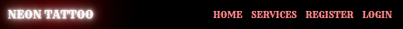

Al iniciar sesión, *Register* y *Login* se sustituyen por *My account* y *Logout*.

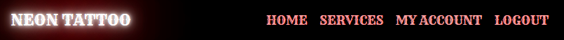

#### Body

Un texto de bienvenida y otro que describe el estudio. Debajo, unas imágenes con efecto neón al pasar el ratón que enlazan con la página personal de cada artista.

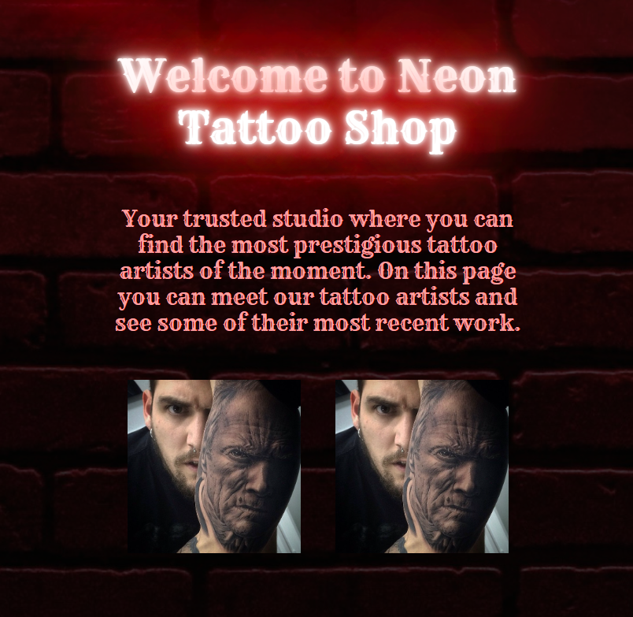

#### Footer

Muestra los tres roles de la aplicación. Al pulsar uno, entras directamente en su vista *My account*, así puedes probar los accesos y funciones de cada rol sin registrarte.

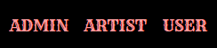

### Services

Describe las disciplinas que se trabajan en el estudio, con imágenes que enlazan a los profesionales que las realizan.

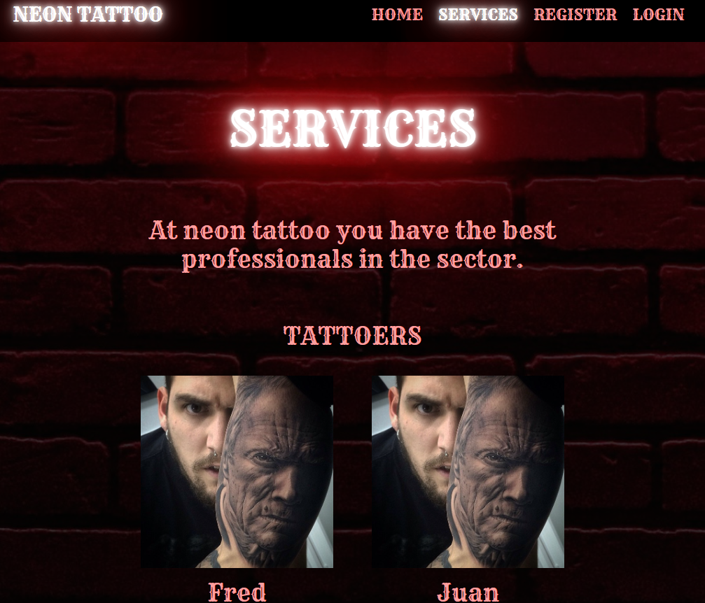

### Register

Formulario de registro de nuevos usuarios, con validación de los campos.

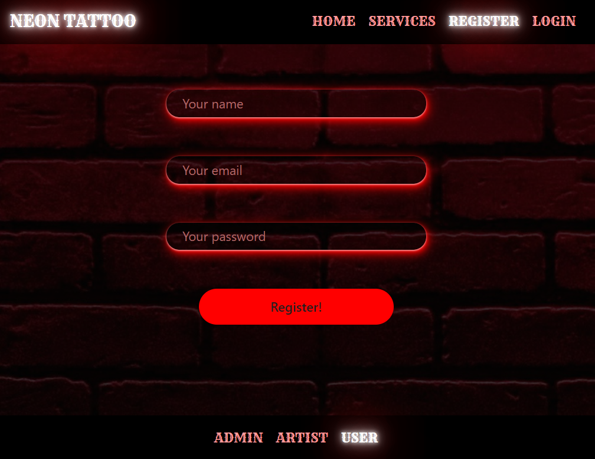

### Login

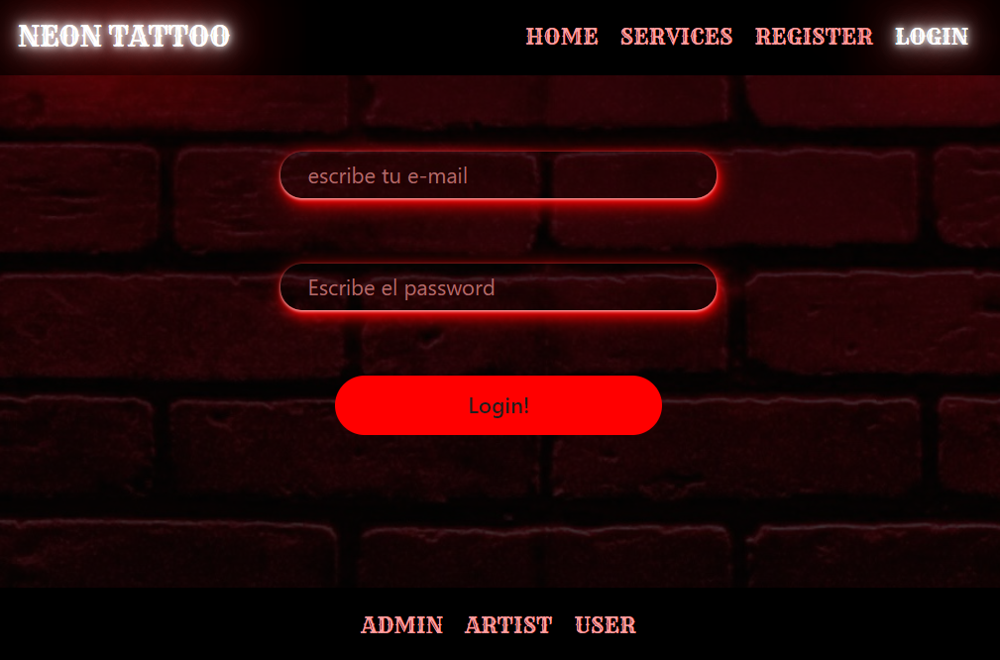

### My Account

Muestra un saludo con tu nombre y los botones a los que tienes acceso según tu rol.

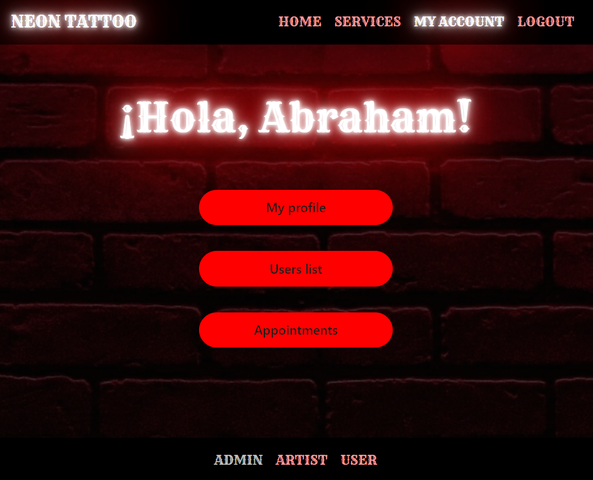

### Edit profile

Al pulsar *Edit profile* se abre un modal para modificar los datos del perfil.

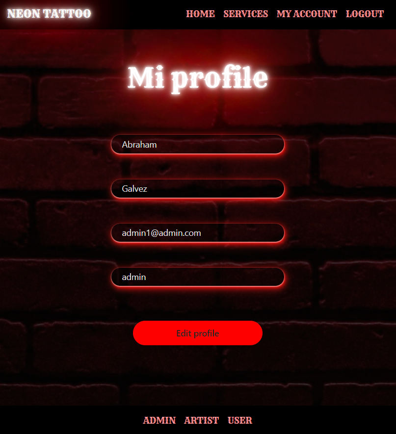

### Users info

Solo para el administrador: buscar y eliminar usuarios.

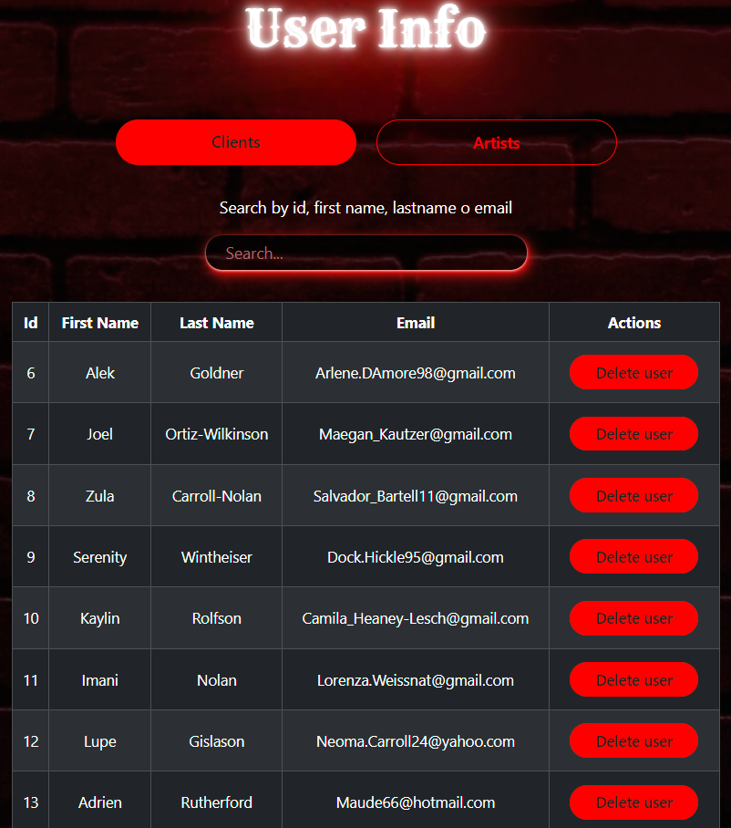

### Citas

El contenido cambia según el rol: el administrador ve todas las citas y puede crear nuevas, mientras que artistas y clientes ven y borran solo las suyas.

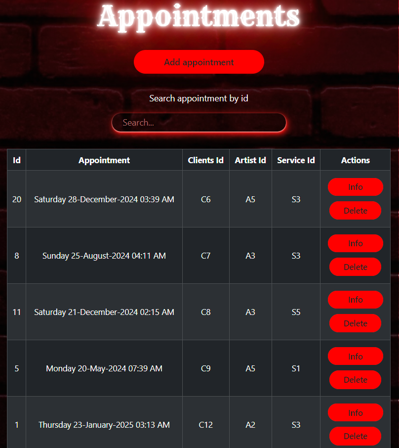

### Página de los artistas

Cada artista tiene su propia página para mostrar sus trabajos y especialidades *(en construcción)*.

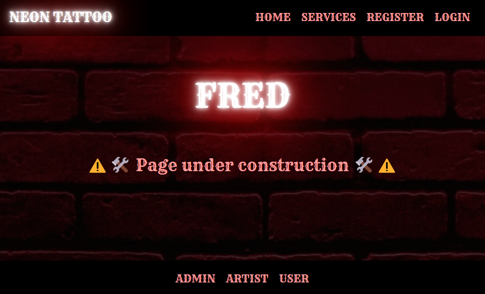

## Futuras funcionalidades 🔮

- [ ] Que el artista tenga que confirmar las citas que crea el cliente.
- [ ] Permitir al administrador cambiar los colores de textos y botones.
- [ ] Completar las páginas personales de cada artista.

## Agradecimientos 🙏

<a href="https://geekshubsacademy.com/" target="_blank">
  
</a>

## Contacto 📬

<p>
  <a href="mailto:abraham.galvez.vives@gmail.com">
    
  </a>
  <a href="https://www.linkedin.com/in/abraham-galvez-vives/" target="_blank">
    
  </a>
</p>
